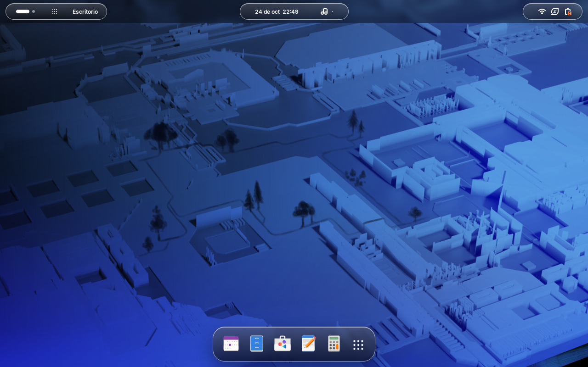
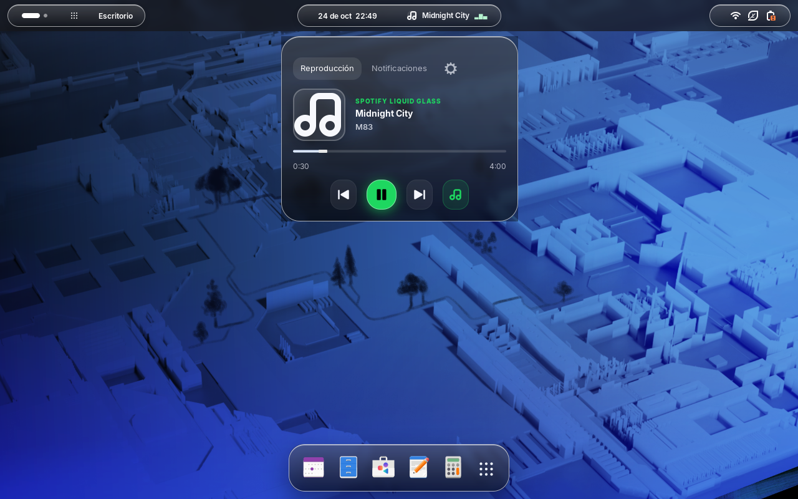
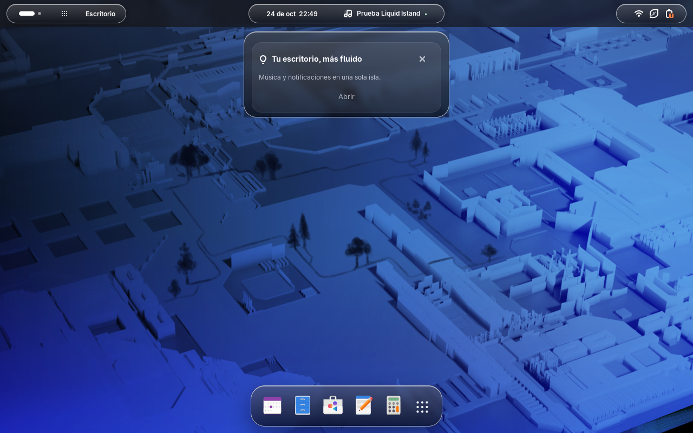
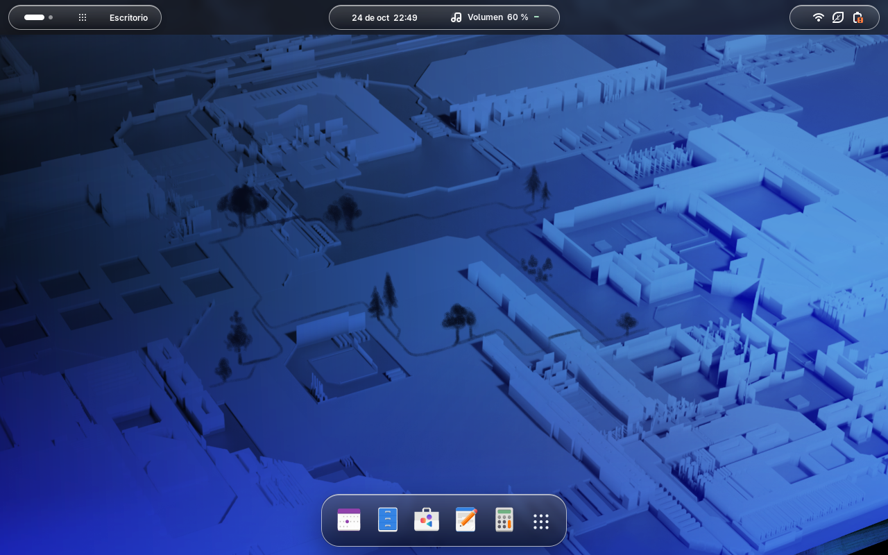
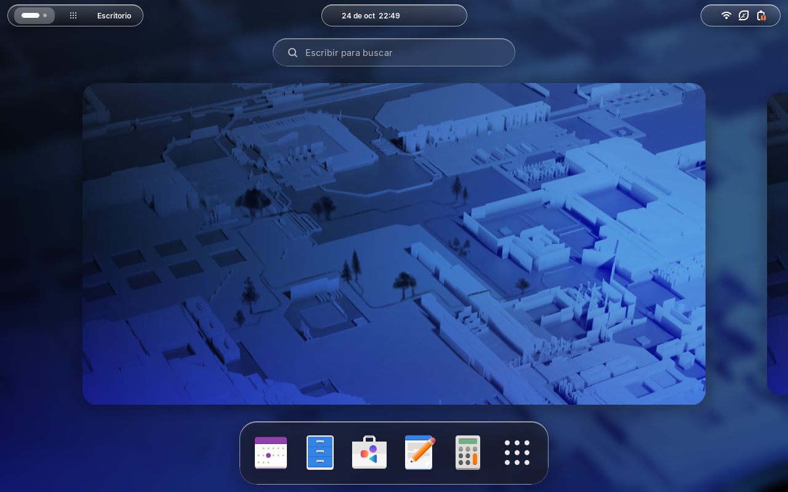
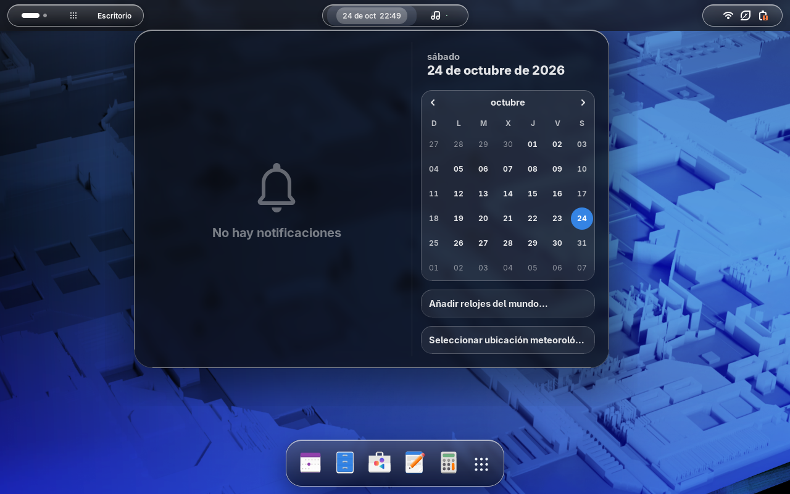

# 🪟 Liquid Glass Linux (macOS Sonoma / Tahoe Aesthetic)

[](https://www.gnome.org/)
[]()
[]()
[]()

Entorno de escritorio completo con estética **Liquid Glass** (*vidrio translúcido esmerilado*), **Dynamic Island** integrada en la barra superior, dock flotante con desenfoque de GPU, tipografía oficial Apple **San Francisco (SF Pro)** y tema **WhiteSur Dark** para GTK4/Libadwaita.

---

## 📸 Vistas Previas

| Barra y Dynamic Island | Reproductor de Música Expandido |
| :---: | :---: |
|  |  |

| Bandeja de Avisos y Notificaciones | Controles de Volumen y Brillo OSD |
| :---: | :---: |
|  |  |

| Vista General (Overview) | Calendario Integrado |
| :---: | :---: |
|  |  |

---

## ✨ Características Principales

1. **Dynamic Island 100% Unificada (`liquid-island`)**:
   - Píldora central única en la barra superior (elimina el botón duplicado de reloj/calendario).
   - Reloj y fecha en vivo integrados de forma nativa sin procesos en segundo plano innecesarios.
   - **Música universal y persistente**: MPRIS descubre reproductores compatibles y los comparte entre la isla y una tarjeta nativa. Al pausar o detener la canción, la tarjeta permanece. Solo desaparece al salir de la aplicación; cerrar su ventana no la oculta si sigue ejecutándose.
   - Menú desplegable con **pestañas intercambiables estilo macOS**: `[ 🔔 Notificaciones ]` y `[ 📅 Calendario ]`, con reproductor multimedia en la cabecera cuando está activo.
   - **Animaciones nativas de resortes (*Spring Physics*)**: Curvas `EASE_OUT_BACK` con resplandor de vidrio líquido para la llegada y despedida de notificaciones.
   - Atajo global configurable: **`Super + I`**.

2. **Herramienta de Fondos (`liquid-live-wallpaper`)**:
   - Reproducción con `mpvpaper` en compositores compatibles con layer-shell, y `mpv` sobre X11. En GNOME Wayland aplica una imagen estática extraída del video; no reproduce un fondo animado.
   - Presets curados: *macOS Sonoma Horizon*, *Liquid Glass Chromatic Flow* y *Dark Acrylic Aurora*.
   - Los fondos de video son una herramienta opcional independiente del motor nativo de widgets.

3. **Efecto Liquid Glass Auténtico (`blur-my-shell`)**:
   - Desenfoque translúcido por hardware (*Dual-Kawase shaders*) acelerado por GPU.
   - Optimización de rendimiento con desenfoque estático (*Static Blur*) en panel y vista general para reducir recapturas del fondo.
   - Lista blanca de ventanas con desenfoque translúcido (`spotify`, `ptyxis`, `nautilus`, etc.).

4. **Tema WhiteSur Dark & Libadwaita**:
   - Ventanas con bordes suaves, reflejo especular superior y botones estilo semáforo de macOS.
   - Inyección directa en `~/.config/gtk-4.0/` y compatibilidad con Flatpak mediante permisos globales.

5. **Tipografía Apple San Francisco (SF Pro)**:
   - Familia tipográfica completa de Apple (`SF-Pro-Display` y `SF-Pro-Text`) preconfigurada con subpixel rendering `rgba` y antialiasing nítido.

6. **Dock Flotante Inteligente**:
   - Dock translúcido inferior con auto-ocultado inteligente (se esconde cuando hay ventanas en primer plano y se muestra en el escritorio limpio o al invocar la vista general sin duplicar el dash nativo).

7. **Suite de Skills para Antigravity (`gnome-rice-architect`)**:
   - Skill incluido en `.agents/skills/gnome-rice-architect/SKILL.md` para asistir de forma autónoma en la personalización y desarrollo de extensiones GNOME, estilos CSS translúcidos y monitoreo de DBus.

---

## 📦 Contenido del Paquete

```
liquid-glass-linux/
├── install.sh                  # Instalador automatizado de 1 paso
├── uninstall.sh                # Restaurador del entorno predeterminado de GNOME
├── backup-live.sh              # Sincroniza personalizaciones hechas en vivo hacia el repo
├── scripts/                    # Scripts de utilidades y fondos
│   └── live-wallpaper.sh       # Motor universal de fondos animados (Sonoma, Liquid Glass)
├── .agents/skills/             # Skills para Antigravity
│   └── gnome-rice-architect/   # Asistente de diseño y arquitectura de escritorio
├── extensions/                 # Extensiones de GNOME Shell incluidas
│   ├── liquid-island@pedrogatti.local           # Dynamic Island & Liquid Glass core
│   ├── blur-my-shell@aunetx                     # Motor de desenfoque GPU Dual-Kawase
│   ├── clipboard-indicator@tudmotu.com          # Historial de portapapeles translúcido
│   ├── appindicatorsupport@rgcjonas.gmail.com   # Bandeja de iconos del sistema
│   └── touchpad-gesture-customization@...       # Gestos avanzados de trackpad
├── themes/                     # Temas visuales
│   ├── WhiteSur-Dark*                           # Variantes del tema GTK
│   └── gtk-4.0/                                 # Hoja de estilos Libadwaita y assets
├── fonts/                      # Fuentes tipográficas
│   └── SF-Pro/                                  # Apple San Francisco (Display y Text)
├── widgets/                    # Widgets de escritorio
│   ├── bin/spotify-glass-widget                 # Binario ejecutable del widget flotante
│   └── desktop/spotify-glass-widget.desktop     # Acceso directo para el menú de apps
├── config/                     # Perfiles de configuración
│   ├── liquid-glass-profile.dconf               # Perfil Dconf curado (sin tocar apps favoritas)
│   └── gnome-all-custom.dconf                   # Respaldo completo de GNOME
└── assets/previews/            # Capturas de pantalla
```

---

## 🚀 Requisitos del Sistema

- **Distribución:** Fedora Linux, Arch Linux, Ubuntu 24.04+, Debian o derivados.
- **Entorno:** GNOME Shell 50 (validado con 50.6 sobre Wayland).
- **Paquetes recomendados:**
  - Fedora: `sudo dnf install -y glib2-devel fontconfig dconf python3-gobject gtk4 libadwaita`
  - Arch: `sudo pacman -S glib2 fontconfig dconf python-gobject gtk4 libadwaita`
  - Ubuntu/Debian: `sudo apt install -y libglib2.0-bin fontconfig dconf-cli python3-gi gir1.2-gtk-4.0 gir1.2-adw-1`

---

## 🛠️ Instalación Rápida (1 Paso)

1. Cloná o descargá el repositorio:
   ```bash
   cd ~/PROYECTOS
   git clone https://github.com/pedrogattii/liquid-glass-linux.git
   cd liquid-glass-linux
   ```

2. Ejecutá el instalador automatizado:
   ```bash
   ./install.sh
   ```

3. **Aplicar cambios en Wayland:**
   - Para que todos los estilos GTK4 y fuentes se refresquen limpiamente en las aplicaciones abiertas, simplemente **cerrá tu sesión de usuario y volvé a ingresar** (*Log out / Log in*).

---

## ⌨️ Atajos de Teclado Preconfigurados

| Atajo | Acción |
| :--- | :--- |
| **`Super + Shift + W`** | Activar / desactivar edición de widgets |
| **`Super + I`** | Desplegar / Ocultar la **Dynamic Island** (reproductor, alertas, volumen) |
| **`Super + V`** | Abrir menú del **Portapapeles** translúcido |
| **`Super + M`** | Abrir bandeja de **Notificaciones y Calendario** |
| **`Super`** *(Windows)* | Abrir la vista general / Overview con desenfoque de fondo |
| **`Ctrl + Alt + Tab`** | Ciclar foco por teclado entre Panel, Dock y Ventanas |

---

## 🎨 Ajustes y Personalización

Abrí **Personalizar Liquid Glass…** desde el menú contextual del fondo o el botón de opciones de la isla. También podés usar `gnome-extensions prefs liquid-island@pedrogatti.local`.

El centro incluye distribución, barra, isla, dock, apariencia, widgets e integraciones. Consultá la [guía de widgets nativos](docs/native-widgets.md). El catálogo propio ofrece música, reloj, calendario con agenda del sistema, clima, CPU, RAM, GPU, lanzadores, notas, tareas, temporizador y acceso rápido a Discord. Activá cada widget individualmente; por defecto solo Música está habilitado y aparece cuando existe un reproductor.

**Super+Shift+W** activa el modo de edición. Arrastrá una cabecera para mover o el tirador para redimensionar. Con la cabecera enfocada, las flechas mueven y Shift+flechas redimensiona; Escape cancela el gesto. También hay controles numéricos y selección de monitor en preferencias. El dock admite los cuatro bordes y los grupos de la barra y los módulos de la isla se pueden reordenar.

El desenfoque de las superficies propias usa la revisión de Blur My Shell incluida en este repositorio, que registra y libera sus superficies externas. Con otras versiones se utiliza el material translúcido de respaldo.

Los widgets quedan bajo las ventanas y se ocultan durante bloqueo y overview. Las posiciones se guardan por conector de monitor; si falta una pantalla, el widget se recupera temporalmente en la principal. La distribución y las preferencias se exportan/importan como JSON versión 1. Los restablecimientos de sección incluyen Deshacer. Notas y tareas se guardan localmente y forman parte de la exportación.

Calendario usa el servicio de calendario de GNOME; Clima necesita GWeather 4 y una ubicación configurada en GNOME Weather. Si faltan, el widget muestra su estado de disponibilidad. Los controles de voz de Discord requieren autorización RPC de Discord y no están habilitados: ver [investigación de integraciones](docs/integrations.md).

**Actualización mientras trabajás:** editar o compilar el repositorio no recarga tu escritorio. El instalador completo aplica el perfil visual; ejecutalo cuando quieras aplicar esos cambios, sin `sudo`. No reinicia el sistema automáticamente. La validación gráfica puede ejecutarse en una sesión headless aislada con `tests/run-shell-smoke.sh` y no interviene en la sesión actual.

Para aplicar todo en el **próximo reinicio**, ejecutá `python3 scripts/next-boot-update.py` sin sudo. Prepara una copia fija y habilita una tarea de usuario, sin iniciarla ahora. Después del reinicio se aplica antes de GNOME: extensiones, perfil visual y temas de Ptyxis/Ghostty disponibles; Brave queda preparado para carga manual. Firefox requiere elegir explícitamente un perfil y no se configura automáticamente. Se conservan los ajustes de la isla y las extensiones ajenas habilitadas; el widget GTK antiguo se deshabilita al aplicar la actualización para dar lugar al nativo. Una salida y entrada sin reiniciar no aplica nada.

La tarea guarda un respaldo y un registro en `~/.local/state/liquid-glass-linux/next-boot/`; solo intenta aplicar una vez, incluso si falla. Consultá `python3 scripts/next-boot-update.py --status` o cancelá antes del reinicio con `python3 scripts/next-boot-update.py --cancel`. Cancelar conserva los respaldos en una carpeta archivada. La tarea no reinicia el equipo ni cierra aplicaciones.


Los temas de aplicaciones se preparan por separado y nunca reinician aplicaciones. Consultá [temas de terminales y navegadores](docs/app-themes.md). La herramienta muestra los cambios por defecto y solo los aplica con `--apply`:

```bash
./scripts/configure-app-themes.sh ptyxis
./scripts/configure-app-themes.sh ghostty
./scripts/configure-app-themes.sh firefox --profile /ruta/al/perfil
./scripts/configure-app-themes.sh brave
```

El widget GPU solo consulta métricas cuando está visible. AMD usa sysfs; NVIDIA puede usar `nvidia-smi` con timeout. Los controladores que no exponen métricas muestran un estado no disponible, sin inventar porcentajes.

### Modificar la intensidad del desenfoque (*Glass Blur*)
Podés ajustar la intensidad del vidrio directamente por terminal o desde la app **Extensiones**:
```bash
# Ajustar intensidad (valor entre 0.0 y 1.0, por defecto 0.85)
gsettings set org.gnome.shell.extensions.liquid-island blur-strength 0.90
```

### Cambiar entre temas Claro, Oscuro o Automático
```bash
# Opciones disponibles: 'auto', 'dark', 'light'
gsettings set org.gnome.shell.extensions.liquid-island appearance 'dark'
```

### Agregar o quitar aplicaciones con desenfoque translúcido
Para que una ventana específica (ej. terminal o navegador) tenga efecto de vidrio, agregala a la lista blanca de Blur My Shell:
```bash
# Consultar aplicaciones actuales
dconf read /org/gnome/shell/extensions/blur-my-shell/applications/whitelist
```

---

## 🔄 Cómo Sincronizar Nuevas Personalizaciones al Repositorio

Si realizás ajustes en tu escritorio (modificás `stylesheet.css`, cambiás fuentes, retocás el código de la isla o agregás nuevos widgets) y querés guardarlos en este repositorio, simplemente ejecutá:

```bash
cd ~/PROYECTOS/liquid-glass-linux
./backup-live.sh
git commit -am "feat: agregada nueva personalización a la isla"
git push
```

---

## 🔙 Desinstalación / Restaurar GNOME

Si querés regresar a la apariencia estándar de fábrica de GNOME:
```bash
./uninstall.sh
```

---

## 🗺️ Personalizaciones del Roadmap

- [x] Temas y transparencia para **Ptyxis** y **Ghostty**, con configuración optativa y respaldo.
- [x] `userChrome.css` para **Firefox** y tema Chromium legítimo para **Brave**; Brave no admite `userChrome.css`.
- [x] Widgets de **CPU, RAM y GPU**, con métricas nativas y consulta opcional NVIDIA.
- [x] Acento dinámico desde la carátula, compartido con la isla y configurable.
- [x] Burbujas translúcidas para notificaciones nativas de **Discord y mensajería**, con selección de aplicaciones. Los controles de voz siguen sujetos a permisos externos.

---

**Creado y optimizado por [pedrogattii](https://github.com/pedrogattii)**.

## Verificación de desarrollo

```bash
./tests/run-checks.sh
./tests/run-shell-smoke.sh
```

Las pruebas de lógica requieren Node.js 24+, Bash y Python 3. Consultá los [resultados de validación](docs/validation.md). La segunda prueba requiere GNOME Shell 50, GJS, GTK4/libadwaita y `dbus-run-session`. Arranca únicamente una pantalla virtual con bus, ajustes y directorios temporales propios. No comprueba Spotify/Brave reales ni altera sus sesiones. La investigación REA está documentada en `docs/integrations.md`.
